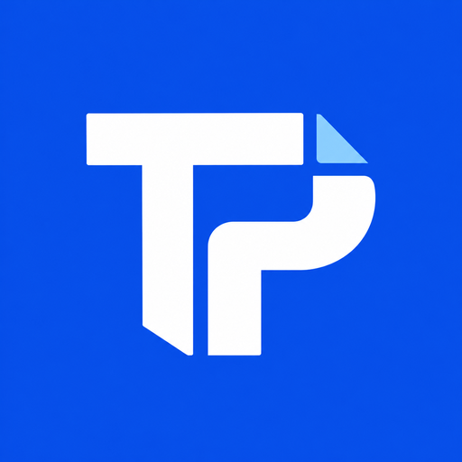

# TendrPro Lite Skills Pack



TendrPro Lite helps procurement and contract professionals evaluate suppliers and prepare tender responses using the documents they already work with. It turns common sourcing tasks into guided AI workflows, with no coding required for day-to-day use.

Once the pack is available in your Claude or ChatGPT workspace, describe the outcome you need in plain language. You do not need to manage API keys, databases, scripts, or separate software.

## What you can do

| Task | What TendrPro Lite produces |
|------|-----------------------------|
| Evaluate suppliers | A requirement-by-requirement assessment, evidence-backed scoring, a ranked shortlist, an award recommendation, and draft supplier letters |
| Prepare a tender response | A structured proposal, compliance matrix, commercial content, formatted PDF, and editable Word document |
| Use reference documents | Evidence drawn from your capability statements, case studies, policies, rate cards, and other approved material |
| Prepare email drafts | Suggested subject lines and copy-ready emails to accompany proposals, evaluations, or supplier letters |
| Check output quality | A review of missing requirements, unsupported conclusions, evidence gaps, and scoring inconsistencies |
| Correct an output | A revised result that records your correction for similar work in future |
| Reuse prior feedback | Relevant corrections from earlier work are applied before a similar task begins |

## Getting started

1. Provide the RFP, ITT, supplier proposals, or reference documents needed for the task.
2. Ask for the outcome in plain language. For example: "Evaluate these supplier proposals against this RFP and explain the evidence behind each score."
3. Review the compliance decisions, evidence, scores, assumptions, and any information marked as missing.
4. If something is wrong, explain the correction so TendrPro Lite can apply it to similar work.

TendrPro Lite works inside the AI workspace and uses its built-in document tools. It does not require an external processing engine or standalone scripts.

## Seven guided workflows

The pack includes seven focused workflows:

- Prepare reference documents for use as evidence
- Evaluate suppliers against an RFP or ITT
- Draft a structured RFP response
- Prepare an email to accompany an output
- Check that evidence is being used accurately
- Apply relevant feedback from earlier work
- Capture corrections and revise the current output

Users do not need to remember workflow names or commands. Describe the procurement task and TendrPro Lite will follow the relevant process.

## Add TendrPro Lite to a workspace

Most procurement users can skip this section. It is for the person who manages the workspace and adds the pack once for everyone who will use it.

### Claude Code

```bash
claude plugin marketplace add amj18/tendrpro-lite-plugin
claude plugin install tendrpro-lite@tendrpro-lite-marketplace
```

Workspace owners can also submit the pack to the [Anthropic directory](https://claude.ai/directory/manage). This requires a paid Claude plan and a public GitHub repository.

### ChatGPT and Codex

Workspace owners can zip the plugin folder and submit it through the [OpenAI plugin portal](https://developers.openai.com/plugins/deploy/submission).

The skills work with Claude or ChatGPT installations that support the plugin format.

## Your documents and data

TendrPro Lite reads only the files and folders you choose, such as RFPs, supplier proposals, reference documents, and previous outputs.

It writes evaluation reports, scoring tables, supplier letters, proposal drafts, email drafts, reference-document indexes, quality reports, and correction notes. Files are saved to the location you choose, or beside the source documents if you do not specify one.

TendrPro Lite sends nothing anywhere. It has no scripts, hooks, MCP servers, network calls, or telemetry. Email content is drafted as text and is never sent automatically.

Supplier scoring follows the evaluation rules stated in the RFP. Missing evidence is marked as Unknown and flagged for clarification; it does not disqualify a supplier by itself. Previous corrections are only applied again when the requirement and evidence have not changed.

## License

Free to use, including at work and inside companies. You may not sell, resell, or bundle the skills into a paid product or service. For commercial licensing, contact the owner. See [`LICENSE`](LICENSE).
